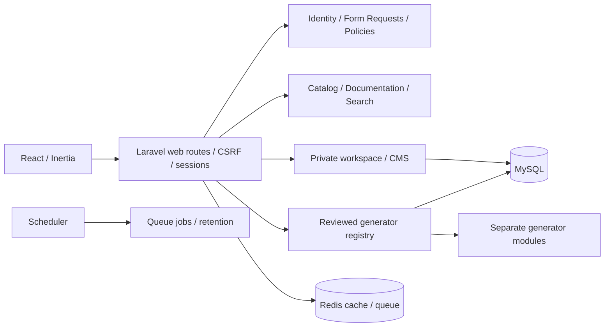

# Architecture

Laravel 13 modular monolith, PHP 8.4+ (current dependency lock), React + TypeScript + Inertia 3, Vite, Tailwind 4, shadcn-style Radix UI primitives and Lucide. Node 22.12+ builds frontend assets. Composer/npm locks are committed. The inspected Ubuntu host has PHP 8.4.27; installed extensions and PHP-FPM must also be checked before staging acceptance.

Controllers separate authentication, account security, catalog, workspace, documentation, administration, feedback, media, generators and monitoring. Services own recovery-code issuance, Turnstile verification, safe media conversion and audit metadata. Ownership policies protect private presets/history/media/feedback; the Admin gate protects every admin route. Admin does not automatically gain another user's script history.

`GeneratorModule` defines ID, schema, validated input and typed output steps. `GeneratorRegistry` is the publication authority in reviewed code. Database status cannot enable a generator. PccModule is an independently coded two-WAN draft; StarlinkModule implements observed dynamic DHCP/Netwatch behavior. Both remain private drafts; G01/G02/G05 fail closed. Named Admin templates store validated parameter sets and cannot publish an engine. GeneratedScript retains step boundaries and warnings. RouterOs provides validated string quoting. No eval, dynamically loaded admin PHP, shell handler, or router execution endpoint exists.

Public routes: `/`, `/tools`, `/tools/{slug}`, `/search`, `/docs`, `/docs/{slug}`, `/pages/{slug}`, `/robots.txt`, `/sitemap.xml`. Authentication routes: `/login`, `/register`, `/recovery`. Private routes: `/dashboard`, `/history`, `/presets`, `/feedback`, `/account`. Admin areas are under `/admin`. See `php artisan route:list --except-vendor` for actual methods. Mutations use CSRF-protected web sessions, not a token in local storage.

Local development/test uses isolated SQLite/file cache where Redis/MySQL are absent. CI runs isolated MySQL/Redis integration checks; private staging additionally verifies the actual database/cache/worker/scheduler and scratch restore. Deployment uses distinct environment, database, storage, session cookie, cache prefix and Redis database per environment. Build artifacts have page-level code splitting. No PWA or payment system is included.
